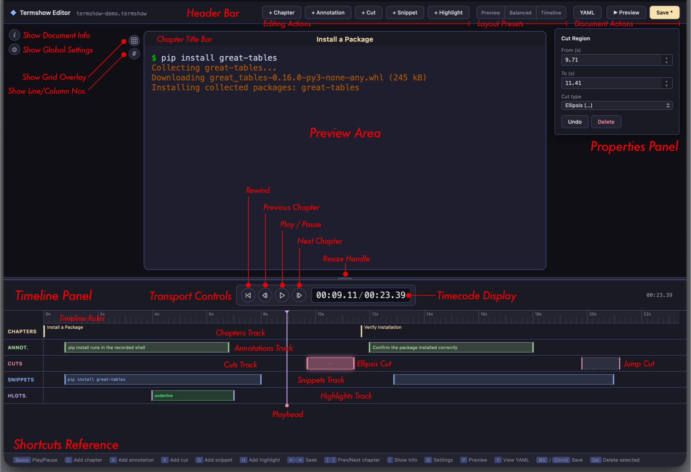

# Terminal Recordings

Great Docs includes **Termshow**, a complete solution for recording, editing, and presenting
terminal sessions in your documentation. A Termshow recording captures everything you type and see
in a terminal with precise timing, stores it in a lightweight format, and renders it as an
interactive player on your site.

Unlike video files or animated GIFs, Termshow recordings render as crisp SVGs at any zoom level,
require no external hosting, and work offline. The full pipeline lives inside Great Docs: record,
annotate, and embed with a single shortcode. For annotation, you can either edit the YAML script
file directly or use the **Termshow Editor**, a browser-based visual editor that lets you add
chapters, annotations, and cuts by dragging and clicking rather than writing timestamps by hand.

Here's what a Termshow recording looks like in action. This one shows a typical workflow:
installing a package and verifying it:



The player above is paused at each chapter boundary, waiting for you to press play. This is the
recommended presentation mode for tutorials: each chapter represents one logical step, giving
readers time to absorb what happened before moving on. Click the play button (or press
) to advance through each chapter at your own pace.

The two chapters in this demo correspond to the two stages of the workflow: installing the
package and verifying the result. You define chapters in a companion YAML file, and the player
renders gold markers on the timeline at each boundary.

## Quick Start

### 1. Record a session

Save recordings in your project's `docs/assets/` directory, which is automatically
available to the `` shortcode at build time.

```bash
great-docs termshow record docs/assets/install-guide.termshow
```

This launches a recording session in your terminal. Everything you type and see is captured with
precise timing. Press  or type `exit` to end.

During the session, you will see status messages confirming the recording is active:

```
Recording... (cols=80, rows=24)
Press Ctrl+D or type 'exit' to stop.
```

These messages are for your benefit only. They are automatically stripped from the saved file so
viewers never see recorder diagnostics in the final output.

The command creates two files:

- `docs/assets/install-guide.termshow`: the raw recording
- `docs/assets/install-guide.termshow.yml`: a script template with commented sections

With the raw recording saved and the script template in place, you're ready to shape the
presentation.

If you'd rather write down what to type and have Termshow record it for you, see
[Scripted Recordings](#scripted-recordings). A scripted recording can be made again whenever the
output changes.

### 2. Edit the script file

Open `docs/assets/install-guide.termshow.yml` and uncomment/fill in the sections you need (or use the
Termshow Editor with `great-docs termshow edit docs/assets/install-guide.termshow`):

```yaml
source: docs/assets/install-guide.termshow

settings:
  window_chrome: colorful

chapters:
  - at: 0.0
    label: Setup
  - at: 8.0
    label: Install
  - at: 15.0
    label: Verify

annotations:
  - at: 1.0
    duration: 3.0
    text: Start by activating the virtual environment
    position: top-right
    style: callout
```

### 3. Embed in a page

```{shortcodes="false"}

```

That single line is all you need. The shortcode handles discovery, rendering, and embedding
automatically during the build step.

### 4. Build

```bash
great-docs build
```

During the build, Great Docs automatically finds all `.termshow` files, renders them into compact
player data, and embeds that data inline in your HTML pages. No runtime fetches are needed.

That's the entire workflow: record, annotate, embed, and build. The following sections cover each
piece in detail.

## The Recording Format

A Termshow recording consists of two files that work together: a raw capture file (`.termshow`)
and an optional script file (`.termshow.yml`). The capture file stores exactly what happened in
the terminal with precise timing. The script file layers presentation choices on top: where to
place chapters, what annotations to show, which segments to cut. This separation means you never
need to re-record just to change how something is presented.

### `.termshow` files

The raw recording is stored as NDJSON (newline-delimited JSON). The first line is a header with
terminal metadata; subsequent lines are events:

```json
{"version": 1, "format": "termshow", "term": {"cols": 80, "rows": 20}, "title": "My Demo"}
[0.5, "o", "$ "]
[0.0, "i", "echo hello"]
[0.1, "o", "echo hello"]
[0.6, "o", "\r\nhello\r\n"]
[1.0, "m", "Step complete"]
[0.3, "o", "$ "]
[0.0, "i", "date"]
[0.1, "o", "date"]
[0.4, "o", "\r\nWed May 28 09:15:03 UTC 2026\r\n"]
```

Each event is `[delay_seconds, type, data]`. The delay is relative to the previous event (not
absolute), and the type code identifies what kind of data the event carries:

| Type | Meaning |
|------|---------|
| `"o"` | Output: data written to the terminal |
| `"i"` | Input: user keystrokes (for display) |
| `"m"` | Marker: internal sync point for chapters |

You rarely need to edit `.termshow` files by hand. The recorder and importer produce them, and
the script file controls how they are presented.

### `.termshow.yml` script files

The companion YAML file controls how the recording is presented. It adds chapters, annotations,
cuts, highlights, and visual settings:

```yaml
source: docs/assets/my-recording.termshow

settings:
  window_chrome: colorful     # Window decoration style
  theme: monokai              # Terminal color scheme
  font_family: "JetBrains Mono, Fira Code, monospace"
  line_height: 1.2            # Line height multiplier
  prompt: "❯"                 # Replace detected prompts with ❯

chapters:
  - at: 0.0
    label: Introduction
  - at: 5.0
    label: Configuration
  - at: 12.0
    label: Running Tests

annotations:
  - at: 1.0
    duration: 3.0
    text: This installs all required dependencies
    position: top-right
    style: callout
  - at: 6.0
    duration: 2.5
    text: Configuration is auto-detected
    position: bottom-right
    style: subtle

cuts:
  - from: 8.0
    to: 11.0
    type: ellipsis

highlights:
  - at: 12.5
    duration: 3.0
    target:
      match: 'All \\d+ tests passed'
    style: spotlight
    color: "#50fa7b"
    fade_in: 0.3
```

Every field is optional, including `source`: the build pairs `NAME.termshow.yml` with
`NAME.termshow` in the same directory. Start with just chapters and add annotations, cuts, or
highlights as you refine the presentation.

::: {.version-only versions=">=0.18"}
The complete format, with JSON Schemas for editor autocompletion and validation, is in
[Termshow File Formats](termshow-file-formats.qmd).
:::

## Settings Reference

The `settings` block in your `.termshow.yml` controls how the recording is rendered into SVG
frames. All settings are optional and have sensible defaults.

| Setting | Default | Description |
|---------|---------|-------------|
| `window_chrome` | `none` | Window decoration style |
| `theme` | `default` | Terminal color scheme (see [Themes](#themes)) |
| `font_family` | (monospace stack) | Font family for rendered SVG |
| `line_height` | `1.5` | Line height multiplier |
| `show_cursor` | `true` | Render the terminal cursor |
| `speed` | `1.0` | Global playback speed multiplier (applied at render time) |
| `prompt` | (none) | Prompt replacement character |
| `prompt_pattern` | (none) | Prompt detection regex |

The `window_chrome` setting accepts `colorful` (traffic-light buttons), `minimal` (grey dots), or
`none` (no title bar). The `font_family` value is a comma-separated list passed directly to the
SVG `font-family` attribute. Lower `line_height` values (around `1.2`) make box-drawing characters
connect vertically. The `prompt` and `prompt_pattern` settings work together for prompt
substitution, described below.

These settings are applied at render time. Changing them requires re-rendering but not
re-recording.

## Themes

The `theme` setting picks the terminal's color scheme: the foreground, background, and the 16 ANSI
colors that programs use for colored output. Use one of the built-in themes by name:

```yaml
settings:
  theme: dracula
```

The built-in themes are shown below, each playing the same short recording so you can compare how
they render prompts, `git` and `ls` output, and the full 16-color palette (normal colors on the
first row of swatches, bright colors on the second).

```{=html}
<style>
.termshow-theme-grid {
  display: grid;
  grid-template-columns: repeat(auto-fill, minmax(190px, 1fr));
  gap: 1rem 1.25rem;
  margin: 1rem 0 1.5rem;
}
.termshow-theme-cell > p { margin: 0 0 0.35rem; }
.termshow-theme-cell .gd-termshow { margin: 0; }
</style>
```

**Dark themes**

:::: {.termshow-theme-grid}
::: {.termshow-theme-cell}
`default`


:::

::: {.termshow-theme-cell}
`catppuccin-mocha`


:::

::: {.termshow-theme-cell}
`dracula`


:::

::: {.termshow-theme-cell}
`github-dark`


:::

::: {.termshow-theme-cell}
`gruvbox-dark`


:::

::: {.termshow-theme-cell}
`monokai`


:::

::: {.termshow-theme-cell}
`nord`


:::

::: {.termshow-theme-cell}
`one-dark`


:::

::: {.termshow-theme-cell}
`rose-pine`


:::

::: {.termshow-theme-cell}
`solarized-dark`


:::

::: {.termshow-theme-cell}
`tokyo-night`


:::
::::

**Light themes**

:::: {.termshow-theme-grid}
::: {.termshow-theme-cell}
`catppuccin-latte`


:::

::: {.termshow-theme-cell}
`github-light`


:::

::: {.termshow-theme-cell}
`gruvbox-light`


:::

::: {.termshow-theme-cell}
`rose-pine-dawn`


:::

::: {.termshow-theme-cell}
`solarized-light`


:::
::::

Names are case-insensitive, and spaces or underscores work in place of hyphens (`Tokyo Night`
resolves to `tokyo-night`). An unknown name stops the render with an error listing the available
themes, so a typo never silently falls back to the default.

To use your own colors, give `theme` a mapping instead. Start from a built-in theme with `base` and
override only what you need:

```yaml
settings:
  theme:
    base: nord
    bg: "#1b1f27"
```

Or define a full theme. The `palette` lists the 8 normal ANSI colors (black, red, green, yellow,
blue, magenta, cyan, white) followed by their 8 bright variants. If you provide only 8 colors, they
are reused for the bright variants:

```yaml
settings:
  theme:
    fg: "#e0e0e0"
    bg: "#101010"
    palette: ["#202020", "#ff5f56", "#27c93f", "#ffbd2e",
              "#4aa8ff", "#c678dd", "#56b6c2", "#e0e0e0"]
```

Any theme mapping can also set `cursor`, the color of the cursor block. Without it, the cursor is
drawn in the foreground color. Of the built-in themes, `catppuccin-mocha` and `catppuccin-latte`
have their own cursor colors.

All colors must be hex values (`#rgb` or `#rrggbb`).

### Light and dark pairs

A single theme looks the same whatever the page's color mode, so a dark recording stays dark when
a reader switches the site to light mode. To follow the page instead, give the recording one theme
for each mode. `auto` uses a built-in pair, `github-light` and `github-dark`:

```yaml
settings:
  theme: auto
```

To choose the pair yourself, give `light` and `dark` themes. Each side can be a theme name or a
mapping, just like a single theme:

```yaml
settings:
  theme:
    light: catppuccin-latte
    dark:
      base: catppuccin-mocha
      bg: "#11111b"
```

This recording uses `theme: auto`. Switch the site between light and dark mode to see it change:



The player switches as soon as the page's mode changes, even during playback. On a page without a
light/dark switch, it follows the reader's system setting. The SVG frame files and the poster
image use the light theme, so in dark mode the light frame can show for a moment while the page
loads.

### Player colors

The player's controls and title bar have a light and a dark look. With a theme pair, they follow
the page's color mode along with the recording. With a single theme, they match the recording's
background: dark controls for a dark theme, light controls for a light one. The shortcode's
`theme` option forces one look either way, and for a theme pair it also picks that side of the
pair (see [Shortcode Reference](#shortcode-reference)).

## Prompt Substitution

Terminal recordings often contain shell prompts that are visually noisy or environment-specific
(e.g., `user@host:~/project $`). The **prompt substitution** feature lets you replace the
prompt character in rendered output with a clean, consistent symbol.

### Configuration

Add `prompt` (and optionally `prompt_pattern`) to your script's `settings` block:

```yaml
settings:
  prompt: "❯"
```

This replaces detected prompt characters with `❯` in all rendered frames. Common replacement
choices include `$`, `%`, `#`, `>`, `❯`, and `→`.

### How detection works

Prompt substitution uses a three-tier detection strategy, applied in order of precision:

1. **Structural detection** (most precise): If the recording contains input (`"i"`) events,
   the renderer correlates them with cursor position to identify exactly which rows have
   prompts and where the prompt character sits. This is fully automatic and requires no
   additional configuration.

2. **Pattern detection** (explicit): If you provide `prompt_pattern`, the renderer uses it as
   a regex to match prompt lines. The last character of the match is replaced. Use this when
   your recording lacks input events or when the structural detection doesn't match your
   prompt format:

   ```yaml
   settings:
     prompt: "$"
     prompt_pattern: '^\S+@\S+[^$]*\$ '
   ```

3. **Heuristic detection** (automatic fallback): When neither input events nor a pattern are
   available, the renderer scans each row for lines that begin with a known prompt character
   (`$`, `%`, `#`, `>`, `❯`, `→`, etc.) followed by a space. This works well for simple
   prompt formats.

The tiers are tried in order: structural first, then pattern, then heuristic. Once a tier matches a
given row, the lower tiers are skipped for that row. In practice, most recordings have input events
and structural detection handles everything automatically.

### Examples

Replace a verbose prompt with a minimal symbol:

```yaml
settings:
  prompt: "❯"
```

Before: `user@dev:~/project$ echo hello`\
After: `❯ echo hello`

Use a regex for non-standard prompts:

```yaml
settings:
  prompt: "$"
  prompt_pattern: '^\(venv\) .*\$ '
```

This matches prompts like `(venv) user@host:~$ ` and replaces just the `$` character.

### Tips

Here are some practical guidelines for working with prompt substitution:

- start with just `prompt`: structural and heuristic detection handle most cases automatically
- add `prompt_pattern` only if the default detection misidentifies prompt lines
- the substitution affects rendered SVG frames only (the raw recording is never modified)
- the Termshow Editor shows prompt substitution live in the preview, so you can see the
  effect immediately as you configure it

In most cases, a single `prompt` line in your settings block is all you need. The detection system
is designed to do the right thing without manual tuning.

## Shortcode Reference

Embed a Termshow recording in any page with the `termshow` shortcode. At its simplest, you only need
the `file` path:

```{shortcodes="false"}

```

The shortcode discovers the companion `.termshow.yml` script, renders the recording into SVG frames,
and embeds everything inline during the build. No additional configuration or runtime fetches are
required.

### Options

The shortcode accepts the following options to control player behavior:

| Option | Default | Description |
|--------|---------|-------------|
| `file` | *(required)* | Path to the `.termshow` file (without extension) |
| `autoplay` | `"false"` | Start playing automatically on page load |
| `loop` | `"false"` | Loop playback when reaching the end |
| `speed` | `"1"` | Initial playback speed multiplier |
| `pause_on_chapters` | `"false"` | Auto-pause at each chapter boundary |
| `poster` | `"0"` | Time (in seconds) of the frame shown before playback starts |
| `controls` | `"true"` | Show the control bar |
| `theme` | `"auto"` | Player color mode: `auto`, `dark`, or `light` (see [Player colors](#player-colors)) |

All options are specified as key-value attributes on the shortcode. Unrecognized options are
silently ignored, so you can safely add new ones as they become available.

The `poster` frame is what readers see before pressing play, so pick a moment that shows what the
recording is about (for example, the finished output) rather than an empty prompt. Playback still
starts from the beginning. Setting `controls="false"` hides the control bar for a cleaner look in
hero sections; keyboard shortcuts and the center play button still work.

The `file` path is relative to the project root and matches the location of the `.termshow` file,
so recordings with the same name in different directories never collide. If no rendered output is
found for a path, the build logs a warning.

### Examples

The following examples show common shortcode patterns, from a minimal embed to more tailored
presentations.

A basic embed with default settings (manual play, 1× speed, controls visible):

```{shortcodes="false"}

```

A chapter-pausing tutorial that stops at each chapter boundary so readers can follow along:

```{shortcodes="false"}

```

A fast autoplay preview for hero sections or landing pages:

```{shortcodes="false"}

```

Combine options freely. For instance, `autoplay` with `loop` creates a continuously cycling
demonstration, while `pause_on_chapters` with `speed="1.5"` produces a brisk but controlled
tutorial.

The shortcode is the only integration point between your Quarto pages and the Termshow pipeline.
Everything else (recording, scripting, rendering) happens automatically during the build.

## Player Controls

The embedded player provides interactive controls for navigating recordings. The following sections
describe what each component does.

### Control Bar

The control bar sits along the bottom edge of the player and provides everything you need to
navigate a recording. Its elements are arranged left to right:

1. **Play / Pause / Replay**: Toggles playback. Shows ↺ at the end of the recording.
2. **Elapsed time**: Current playback position.
3. **Timeline**: Click anywhere to seek. Gold chapter markers indicate chapter boundaries; their hit
targets are wider than the visible marks for easy clicking.
4. **Remaining time**: Counts down to zero during playback.
5. **Speed**: Cycles through 0.5×, 1×, 1.5×, 2×, 3×.

All controls are keyboard-accessible and respond to the shortcuts listed below.

### Chapter Bar

A semi-transparent overlay at the top of the player displays the current chapter name. It updates
as playback progresses and when pausing at chapter boundaries.

### Center Overlay

The center overlay provides a large, easy-to-hit target for the most common playback actions. It
appears as a semi-transparent button in the middle of the viewport and adapts to the current player
state:

- **Before playback**: Shows ▶ as a play call-to-action.
- **After playback ends**: Shows ↺. Clicking it returns the player to its initial state (frame 0)
  without auto-playing.
- **During chapter pauses**: Hidden, so the terminal content remains fully visible for reading.

The overlay never obscures content during active playback; it only appears when the player is
waiting for user input.

### Double-Tap to Seek

During playback (or when the recording has ended), double-tapping or double-clicking the left or
right third of the viewport seeks backward or forward by 5 seconds. This mirrors the seek gesture
familiar from video players: tap the left edge to rewind, or the right edge to skip ahead. Taps in
the middle 40% of the viewport are ignored to avoid conflicts with the center overlay.

### Keyboard Shortcuts

The player responds to these keys while it has focus: tab to it, or click anywhere on the viewport.

| Key | Action |
|-----|--------|
|  | Play / Pause (or reset from ended state) |
|  | Seek forward 5 seconds |
|  | Seek backward 5 seconds |
|  /  | Go to the start / end |
| `]` or `.` | Jump to next chapter |
| `[` or `,` | Jump to previous chapter |

The keys work wherever focus is inside the player (the viewport, the play button, the timeline), and
nowhere else, so they never get in the way of the rest of the page. Shortcuts with
, , or  are left to the browser. When the
timeline has focus,  and  also seek by 5 seconds and
 /  move between chapters, as on any slider.

### Accessibility

The player is built to meet WCAG 2.1 AA, in both its dark and light colors.

- **Keyboard**: the viewport, play button, timeline, and speed button are reached with
   in that order, and each shows a focus ring. Without a control bar
  (`controls="false"`), the viewport can always take focus, so a recording that plays on its own
  can still be paused.
- **Screen readers**: the viewport is labelled with the recording's title. The timeline is a slider
  that reads out the time and chapter (for example, "0:12 of 1:30, chapter: Install"). Stopping at
  a chapter, jumping to one, and reaching the end are announced. The recording's text is in a
  [transcript](#transcripts) that follows the player.
- **Reduced motion**: when the reader has asked their system for reduced motion, the player shows
  the poster frame and waits instead of autoplaying. Pressing play steps through the recording one
  chapter at a time, as with `pause_on_chapters`, and it doesn't loop. Annotations, highlights, and
  copy buttons appear and disappear without fading, and the cursor doesn't blink.
- **Contrast and size**: text in the controls has a contrast of at least 4.5:1, and the progress
  bar, chapter markers, and focus rings at least 3:1. Buttons, copy buttons, and the timeline's
  clickable area are at least 24 pixels tall.

The player's own colors are fixed, but a recording's colors come from its theme. If you make a
custom theme, check that its text stands out from its background.

## Chapters

Chapters divide a recording into labeled sections. They appear as gold markers on the timeline and
enable `pause_on_chapters` mode for step-by-step tutorials.

```yaml
chapters:
  - at: 0.0
    label: Introduction
  - at: 5.0
    label: Installation
  - at: 12.0
    label: Configuration
```

The `at` field is the timestamp in seconds. The `label` is shown in the chapter bar and as a
tooltip on the timeline marker.

### Tips

Here are some guidelines for effective chapter placement:

- Place chapters at logical transitions. Each should represent one distinct step.
- The first chapter at `0.0` names what's on screen before the viewer presses play.
- Use `pause_on_chapters="true"` for tutorials where readers need time to absorb each step.

Well-placed chapters transform a continuous recording into a structured, navigable lesson that
readers can work through at their own pace.

## Annotations

Annotations are contextual overlays that appear at specific timestamps to explain what's happening
in the terminal:

```yaml
annotations:
  - at: 2.0
    duration: 3.0
    text: This installs all dependencies from requirements.txt
    position: top-right
    style: callout
    width: medium
```

Annotations are purely presentational: they don't affect timing or terminal output, and you can
add or remove them at any point without re-recording.

### Styles

Each annotation has a `style` that controls its visual weight:

| Style | Appearance |
|-------|------------|
| `callout` | Dark semi-opaque card with accent border: draws focus |
| `subtle` | Lighter, smaller text: less intrusive |
| `highlight` | Amber-tinted with warm border: strong emphasis |

Choose the style that matches the annotation's importance. Most recordings need only `callout`
and `subtle`; reserve `highlight` for critical warnings or pivotal steps.

### Positions

Annotations can be placed at any edge or corner of the terminal viewport:

| Position | Placement |
|----------|-----------|
| `top-left` | Top-left corner |
| `top` | Top center |
| `top-right` | Top-right corner |
| `left` | Vertically centered, left edge |
| `right` | Vertically centered, right edge |
| `bottom-left` | Bottom-left corner |
| `bottom` | Bottom center |
| `bottom-right` | Bottom-right corner (default) |

Place annotations where they won't cover the terminal text you're explaining. `top-right` is a
good default because most CLI output scrolls along the left edge.

### Width

Control how wide an annotation can grow with the `width` field:

| Width | Max width |
|-------|-----------|
| `small` | 25% of the viewport |
| `medium` | 50% of the viewport (default) |
| `large` | 75% of the viewport |

Use `small` for brief one-word labels, `large` for longer explanations that need breathing room.

### Tips

Keep these principles in mind when adding annotations:

- Keep text to one sentence. Annotations complement the terminal output, not replace it.
- Use `callout` for important explanations, `subtle` for minor context.
- Ensure `duration` is long enough to read at 1.5× speed.

Good annotations enhance comprehension without competing with the terminal content for the
viewer's attention. When in doubt, shorter and fewer is better.

## Cuts

Terminal recordings often contain dead time: waiting for a package to download, watching a
progress bar crawl, or pausing to think about the next command. Cuts let you remove these
segments from the viewer's experience without re-recording. The raw file stays intact; cuts
are purely a playback instruction that tells the player to skip a time range.

```yaml
cuts:
  - from: 8.0
    to: 11.0
    type: ellipsis
```

The `from` and `to` fields define the time range to skip, in seconds of the original recording.
Anything printed during that range isn't lost: playback jumps straight to the screen as it was at
the end of the cut. Cutting a download hides the progress bar but keeps the "done" line it
finished on.

The `type` field marks what kind of skip it is:

| Value | Effect |
|-------|--------|
| `jump` | Seamless jump (no visual indicator) |
| `ellipsis` | Marks a skip that viewers should notice. The Termshow Editor previews it with a brief "…"; the player currently jumps the same way as `jump` |

Use `jump` for short gaps where continuity isn't important (e.g., trimming a 2-second pause
between commands), and `ellipsis` for longer skips (e.g., a 30-second download).

Cuts are non-destructive: they are stored in the script file, not applied to the raw recording.
You can always remove or adjust them later.

### Speeding up a section

When a stretch is worth keeping but drags, play it faster instead of cutting it. A `speed_map`
entry plays a range of the original recording at a different speed:

```yaml
speed_map:
  - from: 20.0
    to: 32.0
    speed: 4      # 12 seconds of test output pass in 3
```

A `speed` below 1 slows a range down. `settings.speed` then applies to the whole result.

### How cuts and speed changes combine

Cuts and speed segments both use the original recording's times, so you can read them straight
off the recording without working out where earlier cuts have moved things. Where they overlap,
the cut wins: only the part of a speed segment outside the cut is played, at that segment's
speed. If two speed segments overlap, the one that starts first applies.

Chapters, annotations, highlights, and snippets are different: their times are on the
**playback** timeline, the one shown on the player after cuts and speed changes. The Termshow
Editor's timeline shows the original recording, so use the Preview to check overlay timing.

## Snippets

Snippets let you add a **copy button** to the player that appears during a time range. When visible,
readers can click it to copy the associated text to their clipboard: no manual retyping needed.

```yaml
snippets:
  - at: 0.5
    duration: 7.0
    text: "pip install great-tables"
    label: Install
  - at: 8.0
    duration: 6.0
    match: '\$ (.+)'
    label: Verify
```

You can provide text in two ways:

- **`text`**: a literal string that gets copied verbatim
- **`match`**: a regex run against the terminal buffer at that moment; copies the first capture
group (or the full match if no group is defined)

If both are set, `match` takes priority (with `text` as fallback if the regex doesn't match).

### Fields

Each snippet entry in the YAML accepts the following fields:

| Field | Default | Description |
|-------|---------|-------------|
| `at` | *(required)* | Time in seconds when the button appears |
| `duration` | `5.0` | How long the button stays visible |
| `text` | `""` | Literal text copied to the clipboard on click |
| `match` | `""` | Regex pattern matched against the visible terminal text |
| `label` | `"Copy"` | Button label shown alongside the copy icon |

At least one of `text` or `match` must be provided.

The button fades in and out smoothly, just like annotations. It appears in the **title bar** at
the far right of the player. Only one snippet button is visible at a time. If time ranges overlap,
the first one wins and subsequent ones are hidden.

### Tips

Practical guidance for working with snippets:

- Snippet time ranges **must not overlap**. The Editor enforces this; if you write overlapping
  ranges manually in YAML, only the first active snippet is shown.
- Align snippets with chapters: set `at` to the chapter start time and `duration` to the chapter
  length. This way the copy button is visible for the entire step.
- Use `text` when you know the exact string (e.g., a `pip install` invocation). Don't include
  prompts (`$`).
- Use `match` when the text is dynamic or you want to extract from what's visible. For example,
  `'\$ (.+)'` matches any shell prompt line and captures just the command. Use single quotes in
  YAML to avoid backslash escape issues.
- Use `label` to give context (e.g., "Install", "Build", "Test") so readers know what they're
  copying without reading the full snippet.
- Snippets work regardless of playback state: readers can copy while paused, playing, or at a
  chapter stop.

Snippets bridge the gap between watching and doing. By giving readers one-click access to the
exact commands shown in the recording, you eliminate transcription errors and reduce friction.

## Highlights

Highlights draw attention to specific terminal text during playback. Unlike annotations (which float
in corners), highlights are **attached to the terminal text itself**: they decorate characters
in-place, can follow scrolling, and support rich adornment styles.

Multiple highlights can be active simultaneously, and overlapping highlights stack naturally
(later ones render on top).

```yaml
highlights:
  - at: 8.0
    duration: 2.0
    target:
      region: { row: 5, col: 0, width: 40, height: 1 }
    style: box
    color: "#f1fa8c"
  - at: 10.0
    duration: 4.0
    target:
      match: 'Successfully installed (.+)'
      group: 1
    style: spotlight
    color: "#50fA7B"
```

### Targeting

A highlight must identify *which text* to decorate. Three targeting modes are available:

| Mode | YAML Key | Description |
|------|----------|-------------|
| **Region** | `target.region` | Fixed rectangle: `{ row, col, width, height }` (0-indexed) |
| **Pattern** | `target.match` | Regex matched against the visible terminal text each frame |
| **Lines** | `target.lines` | List of 0-indexed row numbers to highlight entirely |

For pattern matches, an optional `target.group` (default `0`) selects which capture group to
highlight. This lets you match context (e.g., a full line) while only decorating the interesting
part (e.g., a flag name).

Patterns are JavaScript regular expressions, tried against one row of the screen at a time. The
first row from the top that matches is the one highlighted, and the highlight doesn't appear until
that text is on screen.

**Scroll tracking.** Terminal output scrolls. A region-based highlight is positional: row 5
stays at row 5 even after scrolling pushes new content into that row. A pattern highlight is
placed where its text first appears, and by default it stays there. Set `target.track_scroll:
true` to have it follow the matched text as it moves instead, hiding while the text is scrolled
off-screen. Scroll tracking only works with `target.match` (the player re-runs the regex on each
screen to find the text's new position):

```yaml
highlights:
  - at: 20.0
    duration: 8.0
    target:
      match: 'error:'
      track_scroll: true
    style: underline-wavy
    color: "#ff5555"
```

### Styles

Each highlight has a `style` that controls its visual adornment:

| Style | Visual | Notes |
|-------|--------|-------|
| `outline` | Thin ring around the text | Default style |
| `box` | Bordered rectangle with a faint fill | Technical look |
| `underline` | Solid line beneath the text | |
| `underline-wavy` | Wavy line beneath the text | Reads as "error" or "warning" |
| `background` | Semi-transparent background fill | Good for multi-line selections |
| `spotlight` | Faint fill with a soft glow around it | Draws the eye without a hard border |
| `glow` | Glowing ring around the text | Stronger than `outline` |
| `bracket` | Bar down the left edge | For grouping multiple rows |
| `badge-before` | Outline with a label pill above | Set the label with `badge_text` |
| `badge-after` | Outline with a label pill below | Set the label with `badge_text` |

### Badge Details

The badge styles attach a small label pill to the highlighted text:

```yaml
highlights:
  - at: 18.0
    duration: 5.0
    target:
      region: { row: 3, col: 12, width: 9, height: 1 }
    style: badge-after
    badge_text: "recommended"
    color: "#8be9fd"
```

The `badge_text` field sets the label inside the badge, and `badge_icon` adds a short prefix
(often an emoji) before it. `badge-before` places the pill above the text and `badge-after`
places it below.

### Animation & Transitions

Highlights support animated entry and exit:

| Field | Default | Description |
|-------|---------|-------------|
| `fade_in` | `0.3` | Duration of the appear transition (seconds) |
| `fade_out` | `0.3` | Duration of the disappear transition (seconds) |
| `pulse` | `false` | Gentle pulsing animation that loops continuously |

When `pulse` is enabled, the highlight's opacity oscillates between 100% and 50% on a 1.5-second
cycle with an ease-in-out curve. The animation runs for the entire duration of the highlight. This
works well for drawing attention to transient output or short-lived highlights where you want
sustained visual emphasis.

### Fields Reference

The complete set of fields available for each highlight entry:

| Field | Default | Description |
|-------|---------|-------------|
| `at` | *(required)* | Time in seconds when the highlight appears |
| `duration` | `2.0` | How long the highlight remains visible |
| `target` | *(required)* | Targeting object (see above) |
| `style` | `"outline"` | Adornment style (see table above) |
| `color` | `"#f1fa8c"` | Adornment color (any CSS color, such as hex or rgba) |
| `badge_text` | `""` | Label text for badge styles |
| `badge_icon` | `""` | Short prefix shown before `badge_text` |
| `pulse` | `false` | Enable pulsing animation |
| `fade_in` | `0.3` | Appear transition duration (seconds) |
| `fade_out` | `0.3` | Disappear transition duration (seconds) |

Only `at` and `target` are required. All other fields have sensible defaults and can be omitted
for simple highlights.

### Examples

The following examples illustrate common highlight patterns, from simple region markers to animated
spotlights.

Highlight a fixed region of the terminal:

```yaml
highlights:
  - at: 3.0
    duration: 4.0
    target:
      region: { row: 2, col: 0, width: 80, height: 3 }
    style: background
    color: "rgba(255, 184, 108, 0.15)"
```

Call out a specific flag with a badge:

```yaml
highlights:
  - at: 12.0
    duration: 5.0
    target:
      region: { row: 1, col: 18, width: 8, height: 1 }
    style: badge-before
    badge_text: "new in v2"
    color: "#bd93f9"
```

Spotlight an important result (dims the rest of the viewport):

```yaml
highlights:
  - at: 10.0
    duration: 3.0
    target:
      match: 'All tests passed'
    style: spotlight
    color: "#50fa7b"
    fade_in: 0.3
    fade_out: 0.3
```

These patterns combine freely. A single recording might use `background` for broad context, `badge`
to label a new flag, and `spotlight` for the final result (layering visual cues without competing
for attention).

### Tips

Guidelines for effective use of highlights:

- Highlights are purely visual: they don't affect timing or terminal output.
- Multiple highlights can overlap in time. Unlike snippets, there is no exclusivity rule.
- Use `spotlight` sparingly: it dims the entire viewport and works best for one focal point.
- Combine `pulse: true` with short highlights to draw the eye to transient output.
- Use `track_scroll: true` when highlighting text that may scroll off-screen during the
  highlight's duration.

Highlights are your most expressive tool for directing the viewer's eye. Used judiciously, they
turn a passive recording into an active guided tour of the terminal output.

## Scripted Recordings

A recording made by hand has your typos and pauses in it, and when the tool's output changes you
have to record it again. Instead, you can list the steps in the script and let Termshow type them:

```yaml
record:
  shell: bash --norc
  cols: 90
  rows: 20

steps:
  - marker: Install
  - run: pip install mypackage
  - marker: Verify
  - run: python -c "import mypackage; print(mypackage.__version__)"
  - sleep: 2
```

Save this as `docs/assets/install-guide.termshow.yml` and record it:

```bash
great-docs termshow record --steps docs/assets/install-guide.termshow.yml
```

The steps run in a new shell, out of sight, and the session is saved as
`docs/assets/install-guide.termshow`, next to the script. Commands take as long as they really
take, and the typing has a steady rhythm with a little variation that's the same every time.
Because the steps live in the script, recording again after a release gives you an up-to-date
demo with the same chapters, annotations, and cuts.

### Steps

Each step is a single word or a mapping with one action:

- `run: COMMAND` types the command, presses Enter, and waits for the next prompt.
- `type: TEXT` types text without pressing Enter, and `enter` presses it.
- `key: NAME` presses a key such as `tab`, `up`, `escape`, or `ctrl+c`. Add `count` to press it
  more than once.
- `sleep: SECONDS` waits, still recording whatever the terminal shows.
- `wait_for: PATTERN` waits until a regular expression matches the line the cursor is on. With
  `screen: true`, it matches any row of the screen instead.
- `marker: LABEL` marks a point in the recording. When the script has no `chapters`, markers
  become chapters.
- `hide` and `show` leave a stretch out of the recording, such as setup you don't want to show.

Here's a script that types into an interactive program, waits for its output, and sets up a
directory without showing it:

```yaml
record:
  typing_delay: 0.08
  env:
    NO_COLOR: 1

steps:
  - hide
  - run: cd "$(mktemp -d)" && clear
  - show
  - type: python3 -q
  - enter
  - wait_for: '>>> $'
    timeout: 5
  - type: 6 * 7
  - enter
  - wait_for: "^42$"
    screen: true
  - key: ctrl+d
  - wait_for: '\$ $'
```

`run` waits for the shell's prompt, which is `$ ` by default. Use `type` and `wait_for` for
programs that show a different prompt, as above, or set `record.prompt_pattern` when the whole
session runs in a program with its own prompt. While a stretch is hidden, the recording's clock
is stopped, so the hidden commands' output appears all at once when the recording resumes.
Follow setup that prints something with `clear` to keep it off the screen.

### Settings

The `record` section sets up the shell:

- `shell` is the command to run (`sh` by default). Use `bash --norc` or `zsh -f` to skip your
  startup files, so the recording doesn't depend on how your own shell is set up.
- `cols` and `rows` set the terminal size (80 by 24 by default). `--cols` and `--rows` on the
  command line override them, as `--shell` overrides `shell`.
- `cwd` is the directory to start in, relative to the script.
- `env` sets environment variables. The shell starts with a plain `$ ` prompt and no history
  file, so nothing you record ends up in your own history.
- `inherit_env` (`false`) passes on your whole environment. By default the shell only gets a few
  variables from it, such as `PATH`, `HOME`, and `LANG`, so the recording doesn't pick up
  whatever your shell profile, editor, or CI service has set. That's what keeps a recording
  made on your machine the same as one made in CI. List anything else the steps need in `env`.
- `typing_delay` (0.05 seconds) and `typing_jitter` (0.3) set the typing speed and how much it
  varies. `delay` on a `type`, `run`, or `key` step overrides the speed for that step.
- `timeout` (10 seconds) is how long to wait for a prompt or a pattern. `timeout` on a `run` or
  `wait_for` step overrides it.

The full list is in [Termshow File Formats](termshow-file-formats.qmd#record-steps-and-check).

### When a step fails

If a prompt or pattern doesn't appear in time, the command stops, says which step failed, and
shows the screen as it was. No recording is written, so the previous one is left as it was:

```
✗ steps[3] (wait_for: ^42$): '^42$' didn't appear on the screen within 10s

The screen at the time:
  │ $ python3 -q
  │ >>> 6 * 7
  │ 43
  │ >>>
```

`great-docs termshow validate` checks the steps and settings, so you can catch typos before
recording. It works on a script that hasn't been recorded yet, too:

```bash
great-docs termshow validate docs/assets/install-guide.termshow.yml
```

Scripted recording needs macOS or Linux, since it runs the shell in a pseudo-terminal.

### Checking for drift

A recording shows what your tool printed on the day you recorded it. `termshow check` runs the
steps again and tells you whether the output still matches:

```bash
great-docs termshow check docs/assets/*.termshow.yml
```

For each script, the screen in the new run is compared with the committed recording at every
`marker` and at the end. Only the text is compared, not timing or colors, so a slower machine or
a different color theme doesn't count as a change. When something differs, you get a diff for
each place it does, and the command exits with status 1, so it can fail a CI job:

```
✗ docs/assets/install-guide.termshow has drifted:

  --- install-guide.termshow, at marker 'Verify'
  +++ the steps now, at marker 'Verify'
  @@ -1,3 +1,3 @@
   $ pip install mypackage
  -Successfully installed mypackage-1.4.0
  +Successfully installed mypackage-1.5.0
   $
```

Once you've looked at the changes, `--update` records the drifted recordings again, keeping
their scripts as they are:

```bash
great-docs termshow check docs/assets/*.termshow.yml --update
```

Some text changes on every run: version numbers, dates, timings, temporary paths. List patterns
for it in the script's `check` section, and the matching text is left out of the comparison:

```yaml
check:
  ignore:
    - 'mypackage-\d+\.\d+\.\d+'
    - '\d+(\.\d+)? ?s\b'
    - '/tmp/\S+'
```

The patterns are Python regular expressions, matched against each row of the screen. They're
matched against the commands too, so keep them specific enough not to hide a change you'd want
to see. `--ignore REGEX` on the command line adds a pattern for one run.

Only what's on the screen at each point is compared, so output that has scrolled off the top by
the next marker isn't. A `marker` between commands compares each command's output before the
next one pushes it away, and a taller terminal (`record.rows`) helps with commands that print a
lot. The check runs at the recording's size, whatever the script's `record` section says now.

### Keeping demos up to date in CI

This GitHub Actions workflow does two jobs. On every pull request it checks the demos, and the
job fails if one has drifted, with the diff in its log. Once a week, or when you run it by hand,
it records the drifted demos again and opens a pull request with the new recordings, so a
release that changes your tool's output leads to a demo update you only have to review:

```{.yaml filename=".github/workflows/demos.yml"}
name: Terminal demos

on:
  pull_request:
  schedule:
    - cron: "0 6 * * 1"
  workflow_dispatch:

jobs:
  check:
    if: github.event_name == 'pull_request'
    runs-on: ubuntu-latest
    steps:
      - uses: actions/checkout@v4
      - uses: actions/setup-python@v5
        with:
          python-version: "3.12"
      - run: pip install great-docs .
      - run: great-docs termshow check docs/assets/*.termshow.yml

  update:
    if: github.event_name != 'pull_request'
    runs-on: ubuntu-latest
    permissions:
      contents: write
      pull-requests: write
    steps:
      - uses: actions/checkout@v4
      - uses: actions/setup-python@v5
        with:
          python-version: "3.12"
      - run: pip install great-docs .
      - run: great-docs termshow check docs/assets/*.termshow.yml --update
      # For recordings that a README shows as an animated SVG
      - run: |
          for recording in docs/assets/*.termshow; do
            great-docs termshow export "$recording"
          done
      - uses: peter-evans/create-pull-request@v7
        with:
          branch: update-terminal-demos
          commit-message: Record the terminal demos again
          title: Update the terminal demos
          body: "`great-docs termshow check --update` found demos whose output has changed."
```

`pip install great-docs .` installs your package along with Great Docs, so the steps run the
version of your tool in the pull request. The `update` job can only open a pull request if the
repository allows it: turn on **Allow GitHub Actions to create and approve pull requests** under
**Settings → Actions → General**. Both jobs fail if a step fails, such as a command that isn't
installed on the runner.

A recording made on your Mac and checked on a Linux runner can differ in ways that have nothing
to do with your tool: `sh` is a different shell on each, and paths and some commands' output
differ too. Two things help. Set `record.shell` to `bash --norc` in each script, so the same
shell runs everywhere. And let the `update` job make the recordings, so the ones you commit come
from the same kind of machine that checks them.

To use the results in another tool, or in a job summary, add `--json`. The output is one JSON
object, and the exit status is the same as without it:

```bash
great-docs termshow check docs/assets/*.termshow.yml --json > drift.json
```

```json
{
  "version": 1,
  "summary": {"up_to_date": 0, "drifted": 1, "updated": 0, "failed": 0},
  "results": [
    {
      "script": "docs/assets/install-guide.termshow.yml",
      "recording": "docs/assets/install-guide.termshow",
      "status": "drifted",
      "compared": 3,
      "differences": [
        {"at": "marker 'Verify'", "diff": ["--- install-guide.termshow, at marker 'Verify'", "..."]}
      ]
    }
  ]
}
```

`status` is `up_to_date`, `drifted`, `updated` (with `--update`), or `failed`. A failed result
has an `error` message instead of `differences`, and a `screen` with the screen's text when a
step timed out.

## Importing Existing Recordings

### From asciinema

Already have terminal recordings from asciinema? Import them:

```bash
great-docs termshow import-cast recording.cast docs/assets/my-demo
```

The import preserves timing and terminal dimensions. Create a `.termshow.yml` script afterward to
add chapters and annotations.

The importer produces the same `.termshow` format, so all editing and rendering features work
identically regardless of the original source.

### From VHS tapes

A [VHS](https://github.com/charmbracelet/vhs) tape is a list of steps too, so it converts to a
script that Termshow can record:

```bash
great-docs termshow import-tape demo.tape
```

This writes `demo.termshow.yml` next to the tape. Give a second path to put it somewhere else,
and add `--record` to record it straight away. Here's a tape and the script it becomes:

:::: {.columns}

::: {.column width="45%"}

```{.text filename="demo.tape"}
Output demo.gif
Set Shell "bash"
Set Width 1200
Set Theme "Dracula"
Set TypingSpeed 75ms

Hide
Type "cd examples && clear"
Enter
Show
Type "pip install mypackage"
Enter
Wait@30s
Sleep 500ms
Type "mypackage --version"
Enter
Wait
Sleep 2s
```

:::

::: {.column width="55%"}

```{.yaml filename="demo.termshow.yml"}
settings:
  theme: dracula

record:
  shell: bash --noprofile --norc
  env:
    PS1: '> '
  prompt_pattern: '> $'
  typing_delay: 0.075

steps:
  - hide
  - type: 'cd examples && clear'
  - enter
  - show
  - run: pip install mypackage
    timeout: 30
  - sleep: 0.5
  - run: mypackage --version
  - sleep: 2
```

:::

::::

Each `Type`, key press, `Sleep`, `Wait`, `Hide`, and `Show` becomes a step, and a `Type`,
`Enter`, and `Wait` in a row become a single `run`. `Env` and the `Shell`, `TypingSpeed`,
`WaitTimeout`, and `WaitPattern` settings go in the `record` section. `Theme` (when it's one of
the [built-in themes](#themes), or a set of colors), `WindowBar`, `LineHeight`, `FontFamily`, and
`PlaybackSpeed` go in `settings`.

The script uses VHS's `> ` prompt, so a bare `Wait` in the tape still waits for the prompt. The
shell starts without its startup files, as it does in VHS, so the prompt isn't replaced by yours.
To use the `$ ` prompt that other scripts use, delete `PS1` and `prompt_pattern` from the
`record` section.

Some commands have no equivalent in Termshow. `Output`, `Screenshot`, `Source`, and `Require` are
left out, and so are the settings that only change how VHS draws the video, such as `FontSize`
and `Padding`. The terminal's size isn't converted either, because VHS gives it in pixels: set
`record.cols` and `record.rows` instead. The command lists everything it left out, with line
numbers, and the same list is kept as a comment at the top of the script:

```
✓ Converted demo.tape → demo.termshow.yml (8 steps)
  Not converted:
    line 1: Output demo.gif (the recording is saved next to the script; `termshow export -o demo.gif` makes the GIF)
    line 3: Set Width 1200 (VHS sizes the terminal in pixels; set `record.cols` instead)
  Record it with: great-docs termshow record --steps demo.termshow.yml
```

Once it's recorded, the script works like any other: add chapters, annotations, and cuts, and use
[`termshow check`](#checking-for-drift) to find out when the output changes.

## Rendering & Preview

You can preview and render recordings outside of a full site build using these CLI commands:

### Preview in terminal

```bash
great-docs termshow play docs/assets/my-demo.termshow
great-docs termshow play docs/assets/my-demo.termshow --speed 2
```

Plays the recording directly in your terminal for quick review, with cuts and speed changes from
the companion `.termshow.yml` applied. Use `--no-script` to play the raw recording, or `--script`
to point at a different script file. Asciinema `.cast` files work too. Press
+ to stop.

### Render SVG frames manually

```bash
great-docs termshow render docs/assets/my-demo.termshow
```

Generates the SVG frames and `manifest.json` without a full site build. Useful for inspecting
the output or debugging chapter timing. The command also reports the page payload, the size of
the player data each page embeds:

```
✓ Rendered 107 keyframes (95 unique screens) to docs/assets/termshow/termshow-demo/
  Duration: 23.4s | Chapters: 2
  Page payload: 19.1 KB
```

Both commands work with any `.termshow` file that has a companion `.termshow.yml` script.

## Exporting an Animated SVG

The player needs JavaScript, so it can't run in places like a GitHub or GitLab README. For those,
export the recording as a single animated SVG file:

```bash
great-docs termshow export docs/assets/my-demo.termshow --svg -o my-demo.svg
```

The SVG animates with CSS alone, so it plays anywhere an image can go:

```markdown

```

The export applies the companion `.termshow.yml` the same way the player does: cuts and speed
changes are taken out of the timeline, annotations fade in and out at their times, and the window
chrome and chapter labels appear in the title bar. Highlights and copy buttons need the player, so
they're left out. The file stays small because each distinct screen and each distinct row is stored
once, however often it appears.

These options shape the export:

| Option | Effect |
|--------|--------|
| `-o`, `--output` | Output file. The default is the recording's name with `.svg`. |
| `--chapter-cards` | Pause at each chapter to show its label as a full-screen title card. |
| `--no-annotations` | Leave out the annotations. |
| `--no-loop` | Play once and stop on the last screen. |
| `--end-pause` | Seconds to hold the last screen before looping (default `2`). |
| `--font-file` | Embed a `.woff2`, `.woff`, `.ttf`, or `.otf` font for the terminal text. |
| `--script`, `--no-script` | Use a different script file, or ignore the script. |

An SVG shown as an image can't load web fonts, so the terminal text uses the reader's own monospace
font unless you embed one with `--font-file`. An embedded font isn't trimmed to the characters you
use, so expect it to add its full file size.

### Light and dark READMEs

When the script sets a [light and dark pair](#light-and-dark-pairs), the export writes one file for
each side, `my-demo-light.svg` and `my-demo-dark.svg`, and prints a snippet that shows the one that
matches the reader's color scheme:

```html
<picture>
  <source media="(prefers-color-scheme: dark)" srcset="my-demo-dark.svg">
  
</picture>
```

### Keeping the file small

The command reports each file's size and warns past 2 MB, the point where README viewers start to
struggle. Long stretches of scrolling output are what make an export big, because nearly every
screen is new. [Cuts](#cuts) remove them from the file; speed changes only make them pass faster.

Readers who have turned on reduced motion in their system settings see the last screen as a still
image.

## Exporting to asciicast

To play a recording with asciinema's own player or CLI, or to upload it to
[asciinema.org](https://asciinema.org), export it as an asciicast file:

```bash
great-docs termshow export docs/assets/my-demo.termshow --cast
```

This writes `my-demo.cast` in [asciicast v3](https://docs.asciinema.org/manual/asciicast/v3/), the
format asciinema 3 reads. Add `--v2` for older tools, such as asciinema 2.x and players that only
read version 2. Use `-o` to pick another name; the export won't overwrite the recording it reads.

The companion `.termshow.yml` is applied as far as asciicast allows:

- cuts and speed changes are taken out of the timeline
- chapters become markers, which asciinema's player shows on its progress bar and can pause at
- the script's theme goes in the header, so the colors match. For a light and dark pair, the light
  side is used

Annotations, highlights, snippets and the prompt replacement need the Termshow player, so they're
left out, and the command lists any the script has. Pass `--no-script` to export the recording
exactly as it was recorded. The SVG options (`--chapter-cards`, `--no-loop`, and so on) don't apply
here.

## Exporting a Bundle

`termshow render` writes a directory of files for the player. A bundle has everything the player
needs in one file instead:

```bash
great-docs termshow export docs/assets/my-demo.termshow --bundle
```

This writes `my-demo.termshow.json`, which you can copy, link to, and publish like any other file.
An `-o` name ending in `.termshow.json` picks the bundle format without `--bundle`. Inside is the
recording with its script applied, the same as a render: the screens, chapters, annotations,
highlights, snippets and theme. It also has the recording's [transcript](#transcripts), which the
player adds for screen readers.

To play a bundle, point the [`<termshow-player>` element](#using-the-player-on-any-web-page)'s
`src` at it, or the shortcode's `file` in [any Quarto project](#using-termshow-in-any-quarto-project):

```{shortcodes="false"}

```

The file format is in [Bundles](termshow-file-formats.qmd#bundles).

## Exporting a GIF or Video

Some places can't show an animated SVG either: pull request comments, chat messages, slides, and
social posts. For those, export a GIF, an MP4, or a WebM video:

```bash
great-docs termshow export docs/assets/my-demo.termshow --gif
great-docs termshow export docs/assets/my-demo.termshow -o my-demo.mp4
```

The format comes from `--gif`, `--mp4`, or `--webm`, or else from the `-o` file's extension. Each
screen is drawn the same way as a [screenshot](#taking-a-screenshot), with the theme, window chrome,
chapter labels, prompt replacement, and annotations, and `ffmpeg` joins the screens into the file.
The companion `.termshow.yml` is applied first, so cuts and speed changes are already taken out of
the timeline.

These options apply:

| Option | Effect |
|--------|--------|
| `-o`, `--output` | Output file. The default is the recording's name with `.gif`, `.mp4`, or `.webm`. |
| `--fps` | Frames per second (default `20` for a GIF and `30` for a video). |
| `--scale` | Pixels per SVG unit (default `1` for a GIF and `2` for a video). |
| `--max-idle` | Shorten any pause longer than this many seconds to this length. |
| `--end-pause` | Seconds to hold the last screen (default `2`). |
| `--no-loop` | Play a GIF once instead of repeating it. |
| `--no-annotations` | Leave out the annotations. |
| `--script`, `--no-script` | Use a different script file, or ignore the script. |

The export needs `ffmpeg` (`brew install ffmpeg` or `apt install ffmpeg`), plus `rsvg-convert` or
`resvg` to draw the screens, as for PNG screenshots. As in a PNG screenshot, the terminal text uses
a monospace font installed on your machine, so `--font-file` and `--chapter-cards` only apply to
the SVG export. Annotations appear and disappear at once, without the SVG's fade.

A GIF stores each screen once, shown for as long as it stays up, so a recording with long pauses
stays small. Output that changes faster than the frame rate (a quick burst of lines, say) shows
only its final screen. MP4 and WebM files play at a fixed frame rate and are usually the smaller
choice for long recordings with a lot of scrolling. GitHub won't take an image or a video over
10 MB in an issue or pull request, so the command warns past that size. A lower `--fps` or
`--scale`, `--max-idle`, or [cuts](#cuts) all make the file smaller.

With a [light and dark pair](#light-and-dark-pairs), two files are written, ending in `-light` and
`-dark`. For a GIF, the command also prints a `<picture>` snippet like the
[SVG export's](#light-and-dark-readmes).

## Taking a Screenshot

For a poster image, a social card, or a slide, take a still of one moment:

```bash
great-docs termshow snap docs/assets/my-demo.termshow --at 12.5 -o my-demo.png
```

The screenshot looks like a frame of the [animated SVG](#exporting-an-animated-svg): the same
theme, window chrome, and prompt replacement, with the current chapter's label in the title bar.
The companion `.termshow.yml` is applied first, so `--at` is a time on the playback timeline, after
cuts and speed changes, which is the time the player shows.

Pick the moment with one of these (the default is `--end`):

| Option | Moment |
|--------|--------|
| `--at SECONDS` | That playback time. |
| `--chapter LABEL` | The chapter's last screen, just before the next chapter starts. The label's case doesn't matter. |
| `--end` | The last screen. |

The other options are:

| Option | Effect |
|--------|--------|
| `-o`, `--output` | Output file, ending in `.svg` or `.png`. The default is the recording's name with `-snap.svg`. |
| `--png` | Write a PNG (named with `-snap.png` unless `-o` is given). |
| `--scale` | Pixels per SVG unit in a PNG (default `2`, which stays sharp on high-density screens). |
| `--annotations` | Draw the annotations showing at that moment. |
| `--font-file` | Embed a font for the terminal text (SVG only). |
| `--script`, `--no-script` | Use a different script file, or ignore the script. |

A PNG is made from the SVG by `rsvg-convert` or `resvg`, whichever is installed (`brew install
librsvg` or `apt install librsvg2-bin` gets `rsvg-convert`). The terminal text uses a monospace
font installed on your machine. With a [light and dark pair](#light-and-dark-pairs), two files are
written, ending in `-light` and `-dark`, along with a `<picture>` snippet like the
[export's](#light-and-dark-readmes).

## Transcripts

A recording is a moving picture of text, which screen readers can't read and search engines can't
index. So the build writes a transcript of each one: all the text the player shows, as plain
Markdown. The shortcode puts it after the player, hidden from view but read by screen readers as a
region named "Transcript of the terminal recording". The page's
[Markdown version](05-configuration.qmd#markdown-pages) has the transcript in place of the player, so agents reading
the page get the commands and their output as text.

To read a transcript, or to put one on another page:

```bash
great-docs termshow transcript docs/assets/my-demo.termshow
```

For a recording with two chapters and an annotation, it prints something like this:

````markdown
**Install**

> Install from PyPI with pip

```console
$ pip install my-tool
Successfully installed my-tool-1.0.0
```

**Initialize**

```console
$ my-tool init
✔ Project created successfully!
```
````

The transcript is made from the session as it plays, with the companion `.termshow.yml` applied:

- colors and escape codes are removed, and lines that scroll off the top or are cleared away are
  kept, so nothing the recording showed is lost
- each chapter starts with its label in bold, and each annotation is a quoted note where it shows
- the prompt replacement is applied
- cuts and speed changes don't change the text, only where chapters and notes fall
- a full-screen program, such as `less`, `vim` or `htop`, keeps only its last screen
- the idle prompt at the end is left out

Without a script, the recording's markers are used as chapters. Pass `--no-script` to leave the
script out, or `-o` to write a file instead of printing (it won't overwrite the recording).

### Captions

The command also writes [WebVTT](https://www.w3.org/TR/webvtt1/) files, for a video made from the
recording or for a player of your own. `--vtt` writes the annotations as captions, each shown for
its `duration`; `--vtt-chapters` writes a chapters track, each chapter running until the next one
or the end:

```bash
great-docs termshow transcript docs/assets/my-demo.termshow --vtt -o my-demo.vtt
great-docs termshow transcript docs/assets/my-demo.termshow --vtt-chapters -o my-demo-chapters.vtt
```

Times are on the playback timeline, after cuts and speed changes.

## Validating a Recording

Most mistakes in a script don't stop the build. A misspelled key or position is quietly ignored,
and an annotation timed past the end never shows. The `validate` command finds them:

```bash
great-docs termshow validate docs/assets/my-demo.termshow
```

It checks the recording and its companion `.termshow.yml` (or the one given with `--script`;
`--no-script` checks the recording alone). Each problem names the file and the entry it's in:

```
error: my-demo.termshow.yml: annotations[1].position: must be one of top-left, top, top-right, left, right, bottom-left, bottom, bottom-right; got 'middle'
warning: my-demo.termshow.yml: annotations[2]: starts at 41s, after the end of the recording (23.39s)
warning: my-demo.termshow.yml: snippets[0].match: '\$ (uv .+)' isn't on screen between 0.8s and 11.71s

1 error, 2 warnings
```

**Errors** are things the format doesn't allow: a malformed line in the recording, an unknown key,
a value of the wrong type or outside its allowed set, a cut or speed segment that ends before it
starts, or a `match` that isn't a regular expression. The rules are the ones in the published
[JSON Schemas](termshow-file-formats.qmd#validating-files).

**Warnings** are things that are allowed but probably not what you meant:

- a cut, chapter, annotation, highlight, or snippet that starts after the recording ends
- cuts that overlap each other, or speed segments that do
- chapters out of time order, at the same time, or with the same label
- two annotations in the same position at the same time, which cover each other
- snippets that overlap (only the first one's copy button shows)
- a highlight region or line outside the terminal
- a `match` that never appears on screen while its highlight or snippet is active
- a `match` that uses Python-only regular expression syntax, such as `(?P<name>...)`, since the
  player matches with JavaScript
- a stretch of more than 10 seconds with no output and no cut or speed change over it

Cut and speed segment times are checked against the recording's own length, and everything else
against the length after cuts and speed changes, the same timelines the player uses.

The command exits with status 1 when it finds errors, so it can run in CI. Add `--strict` to fail on
warnings too, and pass several files to check them all at once:

```bash
great-docs termshow validate docs/assets/*.termshow --strict
```

The command also checks a [bundle](#exporting-a-bundle) or a render's `manifest.json`, for one
written by another tool or edited by hand. Beyond the schema, it checks that the keyframes are in
time order from 0, and that each refers to a screen, and each screen to rows, that the file has:

```bash
great-docs termshow validate my-demo.termshow.json
```

## Best Practices

These guidelines help produce recordings that are clear, fast-loading, and pleasant to watch:

- **Keep recordings short**: 15–30 seconds is ideal. Split longer workflows into multiple
  recordings, each embedded with its own shortcode.
- **Use cuts to trim dead time**: Mark boring pauses (downloads, progress bars) as cuts so
  viewers skip them entirely.
- **80 columns, 20 rows** works well for CLI demos. Use 120 columns for wide output like log
  lines or tables. The Termshow Editor auto-scales the preview to fit any terminal size, so
  larger dimensions won't overflow the viewport.
- **Test at different speeds**: Make sure annotations are readable at 1.5× and 2×.
- **Place recordings in `docs/assets/`**: Keep them under the selected configuration directory.
  The build system discovers them automatically.

Following these guidelines ensures your recordings feel polished and load quickly, even on slower
connections.

## How It Works

The Termshow pipeline has two phases:

**Build time** (automatic during `great-docs build`):

1. Discovers all `.termshow` files under the selected configuration directory
2. Parses each recording + its YAML script
3. Captures the screen at each visual change point. Identical screens are stored once, and so
   are identical rows, which is what keeps the data small: most of a terminal stays the same from
   one moment to the next
4. Generates `manifest.json` with timing, chapters, annotations, and those compact screens, plus
   one SVG file per unique screen (used for the poster image), and the
   [transcript](#transcripts), `_transcript.md`
5. The Quarto shortcode filter embeds the manifest inline as JSON, and the transcript after it

**Page load** (JavaScript, no network requests):

1. Reads the inline manifest from an embedded `<script>` element
2. Builds the player UI (viewport, controls, chapter bar, overlays)
3. On play: advances time via `requestAnimationFrame`, drawing each screen as SVG the first time
   it's needed and swapping frames at the correct timestamps

This architecture means zero runtime fetches, full offline support (including `file://` protocol),
and pixel-perfect SVG rendering at any zoom level. Pages built with older versions of Great Docs
(whose manifests list one SVG file per keyframe) keep playing with the current player.

## The Termshow Editor

The Termshow Editor is a browser-based non-linear editor (NLE) for `.termshow` recordings. It
lets you visually add, move, and fine-tune chapters, annotations, and cuts without editing YAML
by hand.

### Launching the Termshow Editor

```bash
great-docs termshow edit docs/assets/my-demo.termshow
```

This opens a local web app at `http://127.0.0.1:8765`. The Termshow Editor loads the recording
and its companion `.termshow.yml` script file (creating one if it doesn't exist). Use `--port`
to change the port or `--no-browser` to suppress the automatic browser launch.

### Interface Layout



The Termshow Editor is divided into these primary areas:

**Header Bar.** The top bar shows the editor title and filename, along with action buttons organized
into thematic groups:

**Editing actions** (left):

- **+ Chapter**: add a chapter marker at the current playhead position (shortcut: )
- **+ Annotation**: add a 2-second annotation at the playhead (shortcut: )
- **+ Cut**: mark a cut region at the playhead (shortcut: )
- **+ Snippet**: add a snippet at the playhead (shortcut: )
- **+ Highlight**: add a highlight at the playhead (shortcut: )

**Layout presets** (center): A segmented button with three view presets that control the
split between the Preview Area and the Timeline Panel:

- **Preview**: 75/25 split: maximizes the terminal view for inspecting output
- **Balanced**: 50/50 split: equal space for preview and timeline (default)
- **Timeline**: 25/75 split: maximizes the timeline for detailed editing

**Document actions** (right):

- **YAML**: View the generated YAML script (shortcut: )
- **▶ Preview**: Open the production preview modal (shortcut: )
- **Save**: Write changes to the `.termshow.yml` file (shortcut:  /
  ). Pulses gold when there are unsaved changes.

**Preview Area.** The center panel shows a live terminal preview. It renders the recording state at
the current playhead position, updating in real time as you scrub, drag edges, or play back.

The viewport uses **auto-fit scaling**: the terminal always renders at its native character grid
(matching the recorded dimensions), then scales proportionally to fill the available space. This
means wide recordings (120 columns) and tall recordings (40+ rows) display without clipping or
scrollbars. When you expand the preview area (via the resize handle or layout presets), the terminal
scales up to fill it. The scaling recalculates on window resize and during drag.

Above the terminal viewport, a **Chapter Title Bar** displays the currently active chapter name,
simulating the window chrome appearance of the final player.

**Settings Button**: A small circular gear (⚙) button sits in the top-left corner of the
Preview Area, next to the Info Button. Clicking it (or pressing ) toggles the
**Settings Panel** described above.

**Info Button**: A small circular *i* button sits in the top-left corner of the Preview Area.
Clicking it (or pressing ) toggles the **Info Panel**, a floating overlay showing
recording metadata:

- terminal dimensions (cols × rows)
- duration (effective, accounting for cuts; raw duration shown in parentheses when cuts exist)
- event count (total and output events)
- chapter, annotation, and cut counts
- source file size
- estimated keyframe count and rendered SVG size

The Info Panel updates live as you add or remove items. Click the `×` in its top-right corner
or press  again to dismiss it.

**Resize Handle.** A draggable divider between the Preview Area and the Transport/Timeline section.
Drag it down to enlarge the terminal preview (the terminal scales up to fill), or drag it up to give
more space to the timeline tracks. The preview area has a minimum height of 150px, and the timeline
area is clamped so all three tracks remain visible. Manually dragging clears the active layout
preset indicator.

**Transport Controls.** Below the resize handle, centered transport controls provide:

- **Rewind** (⏮): Jump to the start of the recording
- **Previous Chapter** (⏴): Jump to the previous chapter marker (shortcut: `[`)
- **Play/Pause** (▶/⏸): Toggle playback (shortcut: )
- **Next Chapter** (⏵): Jump to the next chapter marker (shortcut: `]`)
- **Timecode Display**: Shows elapsed time / total duration in `MM:SS.cc` precision. Click the
  current-time value to type an exact position (e.g., `01:23.45`) and press  to jump there.

**Timeline Panel.** The bottom panel contains five track lanes beneath a **Timeline Ruler**, the
graduated strip showing time markings. Click anywhere on the ruler to reposition the playhead
instantly, or drag the playhead indicator to scrub through the recording. The ruler is the safest
place to navigate without accidentally selecting or creating items.

1. **Chapters Track**: Gold vertical markers. Click a marker to select it; drag to reposition.
   Double-click empty space to add a new chapter with placeholder text.

2. **Annotations Track**: Green boxes spanning their time duration. The annotation text is shown
   inside each box (clipped if too long). Click a box to select it; drag to reposition.
   Boxes have left and right edge handles for resizing. Double-click empty space to add a 2-second
   placeholder; drag across the track to create a custom-duration annotation.

3. **Cuts Track**: Red (ellipsis) or purple-dashed (seamless) blocks. A centered `⋯` symbol
   distinguishes ellipsis cuts. Click a box to select it; drag to reposition. Boxes have edge
   handles. Double-click empty space to add a 2-second cut; drag across the track to create a
   custom-length cut.

4. **Snippets Track**: Blue boxes showing the snippet text. Click a box to select it; drag to
   reposition. Boxes have edge handles for resizing the time range. Double-click empty space to
   add a 5-second placeholder; drag across the track to create a custom-duration snippet.

5. **Highlights Track**: Color-coded boxes styled per highlight type (cyan for box, green for
   underline, yellow for background, orange for spotlight, pink for badge). Click a box to select
   it; drag to reposition. Boxes have edge handles for resizing. Double-click empty space to add
   a 3-second highlight; drag across the track to create a custom-duration highlight. Unlike
   snippets, **highlights may overlap in time** (multiple highlights can be active simultaneously).

A **Playhead** (white vertical line) spans all five tracks and moves with the current time.

### Global Settings Panel

The Termshow Editor includes a **Global Settings** panel for configuring global script settings
visually. Click the gear icon (⚙) in the top-left corner of the Preview Area or press
 to toggle it.

The Settings panel exposes the following controls:

| Control | Description |
|---------|-------------|
| **Default speed** | Playback speed multiplier (dropdown: 0.5×, 1×, 1.5×, 2×, 3×) |
| **Chrome** | Window decoration style (dropdown: colorful, minimal, none) |
| **Font family** | Comma-separated font stack for rendered output |
| **Prompt** | Replacement character for prompt substitution, with preset buttons |
| **Pattern** | Regex pattern for prompt detection (see [Prompt Substitution]) |

All changes apply immediately to the live preview so you can see the effect of each setting in real
time. Settings are saved to the `settings` block of the `.termshow.yml` file when you press Save.

Press  or click outside the panel to dismiss it.

### Properties Panel

Clicking any item in the timeline opens the **Properties Panel** on the right side. The panel adapts
to show fields relevant to the selected item type, and all edits are live: changes apply immediately
as you type, with no Apply button needed.

For **chapters**, the panel shows the timestamp and label text. **Annotations** add duration, the
annotation body, and dropdowns for position, width, and style. **Cut regions** expose the start and
end times along with the cut type (jump or ellipsis). **Snippets** include the time range, literal
copy text or regex match pattern, and a label for the button.

**Highlights** have the richest panel: in addition to timing and style, you can configure the target
(a fixed region, regex pattern, or line list), color and opacity, fade transitions, pulse animation,
and badge-specific options like label text and placement.

Every panel also includes an **Undo** button (which reverts the item to its state when the panel
opened) and a **Delete** button to remove the item entirely. Because changes are live, you can watch
the terminal preview update as you adjust values.

### Edge Editing

Annotation boxes, cut regions, snippet boxes, and highlight boxes all have draggable edge handles
(left and right). When you grab an edge:

1. The **playhead snaps** to that edge's time position, showing the exact terminal frame at the
boundary.
2. The edge displays a **prominent vertical stem** extending beyond the track (green for
annotations, red for cuts, blue for snippets, style-colored for highlights) with a directional
glow so you know which side is active.
3. **Arrow keys** (← →) nudge the active edge by ±10ms for frame-accurate positioning. The
playhead tracks the edge so you can see the terminal state update with each nudge.

Clicking elsewhere or pressing  deselects and restores normal edge appearance.

### Drag-to-Create

On the Annotations, Cuts, Snippets, and Highlights tracks, clicking and dragging across empty
space creates a new item spanning the drag distance. The drag only initiates after a 4-pixel
movement threshold, preventing accidental creation from stray clicks. If you want a fixed-size
item without dragging, double-click instead (creates a 2-second item for annotations/cuts,
5-second for snippets, or 3-second for highlights).

### Cut Types

The two cut types have distinct visual appearances in the timeline:

| Type | Appearance | Playback Effect |
|------|-----------|-----------------|
| **Seamless** | Purple dashed block (no symbol) | Silent jump with no visual indicator |
| **Ellipsis** | Solid red block with `⋯` symbol | Shows a 1 second "⋯" overlay during playback |

Switch between types using the "Replace With" dropdown in the properties panel.

### Keyboard Shortcuts

The Termshow Editor supports these keyboard shortcuts for efficient editing:

| Key | Action |
|-----|--------|
|  | Play / Pause |
|  | Add chapter at playhead |
|  | Add annotation at playhead |
|  | Add cut at playhead |
|  | Add snippet at playhead |
|  | Add highlight at playhead |
|  | Toggle global settings panel |
|  | Toggle info panel |
|  /  | Seek ±1 second (or nudge active edge ±10ms) |
| `[` / `]` | Jump to previous / next chapter |
|  | View YAML |
|  | Preview |
|  /  | Delete selected item |
|  | Close settings/properties panel, deselect |
|  /  | Save |

### Unsaved Changes

Any modification (adding, moving, editing, or deleting items) marks the session as dirty. The
Save button changes to Save* with a pulsing gold glow to indicate unsaved changes. Saving resets the
indicator.

### Preview

The **Preview** button (shortcut: ) opens a full-screen modal showing your recording
exactly as it will appear on a built site. Unlike the in-editor live preview (which shows the raw
SVG frame at the current playhead), the Preview modal renders the complete player using Quarto with
the production `termshow` shortcode, embedded fonts, dark theme, and autoplay enabled.

This lets you verify the final presentation (including the control bar, chapter markers, speed
controls, and annotations) without running a full site build.

The modal provides three tabbed viewports at fixed widths:

| Tab | Viewport Width | Use Case |
|-----|---------------|----------|
| **Desktop** | 900px | Standard laptop/desktop browser |
| **Tablet** | 600px | Tablet or narrow browser window |
| **Mobile** | 375px | Phone-sized viewport |

Switch between tabs to verify that the player renders well at each breakpoint. The player is fully
interactive within each viewport: you can play, pause, seek, and test chapter navigation.

The preview is generated on-demand by rendering a temporary page that is fully self-contained with
no external dependencies. Generation takes a few seconds and a loading indicator is shown while the
render completes.

Press  or click outside the modal to close it.

### Recommended Workflow

1. **Record** the terminal session into `docs/assets/` with `great-docs termshow record docs/assets/demo.termshow`.
   This creates a paired set of files:
   - `docs/assets/demo.termshow`: the raw recording (timing + terminal output)
   - `docs/assets/demo.termshow.yml`: the script file (chapters, annotations, cuts, settings)

   Both files are always required. The `termshow record` command creates both automatically. The
   `.yml` file is generated with commented template sections you can uncomment and fill in.
   The `docs/assets/` directory is recommended because it is automatically available to the
   `` shortcode at build time.

2. **Open the Termshow Editor** with `great-docs termshow edit docs/assets/demo.termshow` to visually
edit the script.
3. **Play through once** to get familiar with the recording's content and timing. Click the
**Timeline Ruler** (the graduated strip above the tracks) to scrub to any point.
4. **Add chapters** at logical transitions: double-click the Chapters Track or press
 at each transition point.
5. **Add annotations** to explain key moments: drag across the Annotations Track to set the
exact duration, or double-click for a 2-second default. Edit the text in the Properties Panel.
6. **Mark cuts** to remove dead time: drag across the Cuts Track to select the boring parts.
Use "ellipsis" for long skips (so viewers know time was removed) and "seamless" for short
gaps (smooth editing).
7. **Fine-tune edges**: click an edge handle, then use arrow keys to nudge it frame-by-frame
while watching the terminal preview update.
8. **Preview**: press  to open the production preview and verify the final player at
desktop, tablet, and mobile widths.
9. **Save** and embed in a page with the `` shortcode.

The Termshow Editor saves only to the `.termshow.yml` script file. The raw recording is never
modified, so you can always start fresh by deleting the script and re-editing.

## Using Termshow in Any Quarto Project

The Termshow player is available as a **standalone Quarto extension** that works outside of Great
Docs. This means you can embed terminal recordings in any Quarto document (including revealjs
presentations, standalone websites, and blogs) without building a full Great Docs site.

### Install the extension

Install the Termshow extension directly from the Great Docs repository:

```bash
quarto add posit-dev/great-docs/extensions/termshow
```

This installs the player shortcode, styles, JavaScript runtime, and fonts into your project's
`_extensions/` directory. No other Great Docs components are required.

### Record and render

You still need the Great Docs CLI for recording and rendering terminal sessions:

```bash
pip install great-docs
```

Record a session as usual:

```bash
great-docs termshow record my-demo.termshow
```

Then optionally edit the companion `.termshow.yml` script (either by hand or with the Termshow
Editor via `great-docs termshow edit my-demo.termshow`) to add chapters, annotations, and cuts.

Since there is no `great-docs build` step in a standalone project, you need to explicitly render
the recording into SVG frames:

```bash
great-docs termshow render my-demo.termshow
```

This produces a `termshow/<name>/` directory containing SVG keyframes, a `manifest.json`, and the
[transcript](#transcripts) the shortcode puts after the player. Move or copy this directory into
your Quarto project root if it isn't there already.

Or export a [bundle](#exporting-a-bundle), one file you can keep anywhere in the project:

```bash
great-docs termshow export my-demo.termshow --bundle
```

### Register termshow output as a resource

Add the rendered output to your project's resources so Quarto includes it in the build output.
In your `_quarto.yml`:

```yaml
project:
  resources:
    - termshow/**
```

A bundle doesn't need this: the shortcode embeds all of it in the page.

### Embed with the shortcode

Use the same `` shortcode as in a Great Docs site:

```{shortcodes="false"}

```

For a bundle, `file` is its path, relative to the document or else to the project root:

```{shortcodes="false"}

```

A bundle has no SVG files, so the page has no poster image before the player starts.

All shortcode options (`autoplay`, `loop`, `speed`, `pause_on_chapters`, `controls`, `theme`) work
identically. The extension handles CSS, JavaScript, and font injection automatically via Quarto's
dependency system.

### Supported formats

The standalone extension works with any Quarto HTML-based format:

- **Websites** (`type: website`)
- **RevealJS presentations** (`format: revealjs`)
- **Single HTML pages** (`format: html`)
- **Books** (`type: book`)

The player adapts to available width and works with both light and dark themes.

### Sizing tips for RevealJS presentations

By default the Termshow player scales to fill the full slide width. On a RevealJS slide this can
make the terminal too large for the viewport, especially at 1920×1080 resolution where the
recording may overflow the bottom of the slide.

To fit it comfortably, add a small CSS file and reference it in your YAML header.

Create a `termshow-slides.css` file in your project:

```css
/* termshow-slides.css */
.reveal .gd-termshow {
    max-width: 70%;         /* adjust to taste */
    margin-inline: auto;
}
```

Then reference it in the YAML header of your presentation:

```yaml
format:
  revealjs:
    css: termshow-slides.css
```

A few guidelines:

- **Start around 70–75%** and adjust from there. The right value depends on your terminal
  dimensions (an 80-column recording needs less room than a 120-column one) and your slide
  aspect ratio.
- **Use `margin-inline: auto`** to center the player on the slide.
- **Avoid setting a fixed `height`**. The player maintains its aspect ratio automatically;
  constraining only the width lets it scale naturally.
- **Preview at presentation resolution** (typically 1920×1080 or 1280×720) to verify the recording
  fits comfortably within the slide bounds.

## Using the Player on Any Web Page

Sites that aren't built with Quarto, such as MkDocs, Sphinx, Docusaurus, or hand-written HTML, can
use the player as a `<termshow-player>` element. It's the same player as the shortcode, with the
same controls, themes, and overlays.

### Copy the player files

The player is a script, a stylesheet, and two font files. Copy them into your site:

```bash
great-docs termshow assets site/player
```

The command prints the tags that load them. The fonts must stay next to `termshow.css`, which
loads them by relative URL.

### Export the recording

Export the recording into the site as a [bundle](#exporting-a-bundle):

```bash
great-docs termshow export my-demo.termshow -o site/my-demo.termshow.json
```

The bundle has the recording's [transcript](#transcripts), and the element puts it after the
player, hidden from view but read by screen readers.

A render directory works too (`great-docs termshow render my-demo.termshow -o
site/termshow/my-demo`), but it has no transcript inside it. To give screen readers the recording's
text, put the transcript in the page next to the element, from `site/termshow/my-demo/_transcript.md`
or `great-docs termshow transcript`.

### Add the element

Load the player in the page's `<head>`, and put a `<termshow-player>` where the recording should
appear:

```html
<link rel="stylesheet" href="player/termshow.css">
<script src="player/termshow.js"></script>

<termshow-player src="my-demo.termshow.json" autoplay loop></termshow-player>
```

`src` is the URL of a bundle or a manifest file, or a render directory, for which the player loads
the `manifest.json` inside it. Paths are relative to the page.

Most browsers won't load the file for a page opened straight from disk (a `file://` URL), so
preview the page through a local server, such as `python -m http.server`. Or embed the bundle in
the element, which needs no server:

```html
<termshow-player>
  <script type="application/json" class="gd-tp-manifest">
    …the contents of my-demo.termshow.json…
  </script>
</termshow-player>
```

Bundles and `manifest.json` files are written so that they're safe to paste inside a `<script>`
element.

### Element attributes

The attributes match the [shortcode options](#options):

| Attribute | Default | Description |
|-----------|---------|-------------|
| `src` | (none) | Bundle or manifest URL, or render directory |
| `autoplay` | off | Start playing once loaded |
| `loop` | off | Restart from the beginning at the end |
| `speed` | `1` | Initial playback speed multiplier |
| `pause-on-chapters` | off | Pause at each chapter |
| `poster` | `0` | Time, in seconds, of the screen shown before playback |
| `controls` | on | Show the control bar |
| `theme` | `auto` | Player colors: `auto`, `dark`, or `light` |

The on/off attributes are on when present, as in `<termshow-player autoplay>`, and off when set to
`"false"`, which is how you hide the controls: `controls="false"`. Changing an attribute reloads the
player with the new settings.

Anything inside the element shows until the player starts, and stays if JavaScript is off. A
rendered frame makes a good stand-in:

```html
<termshow-player src="termshow/my-demo">
  
</termshow-player>
```

### Controlling the player from a script

The element has a small API, modeled on the HTML `<video>` element:

| Member | Description |
|--------|-------------|
| `play()`, `pause()` | Start and stop playback. After the end, `play()` starts again from the beginning |
| `seek(seconds)` | Jump to a time |
| `currentTime` | The current time, in seconds. Setting it seeks |
| `duration` | The length, in seconds (`NaN` until loaded) |
| `paused` | Whether playback is stopped |

It also fires `ready` once the recording has loaded, then `play`, `pause`, and `ended` as playback
changes:

```js
const player = document.querySelector("termshow-player");
player.addEventListener("ready", () => player.seek(12));
player.addEventListener("ended", () => console.log("done"));
```

In a Quarto or Great Docs page, keep using the `termshow` shortcode: it embeds the recording in the
page for you.

## Next Steps

Terminal recordings bring CLI workflows to life with crisp, interactive playback directly in your
documentation. Combined with chapters and annotations, they replace static code blocks with
guided, self-paced walkthroughs that readers can pause and study.

- [Videos](22-videos.qmd): embed video content for non-terminal demos and walkthroughs
- [CLI Documentation](07-cli-documentation.qmd): auto-generate reference pages for the commands you record
- [Diagrams](19-diagrams.qmd): complement terminal demos with architecture and flow visualizations
- [Theming](11-theming.qmd): customize player colors and appearance to match your site
- [Building](13-building.qmd): how Termshow shortcodes fit into the Quarto build pipeline
